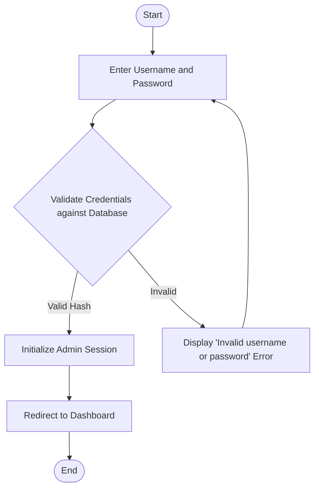
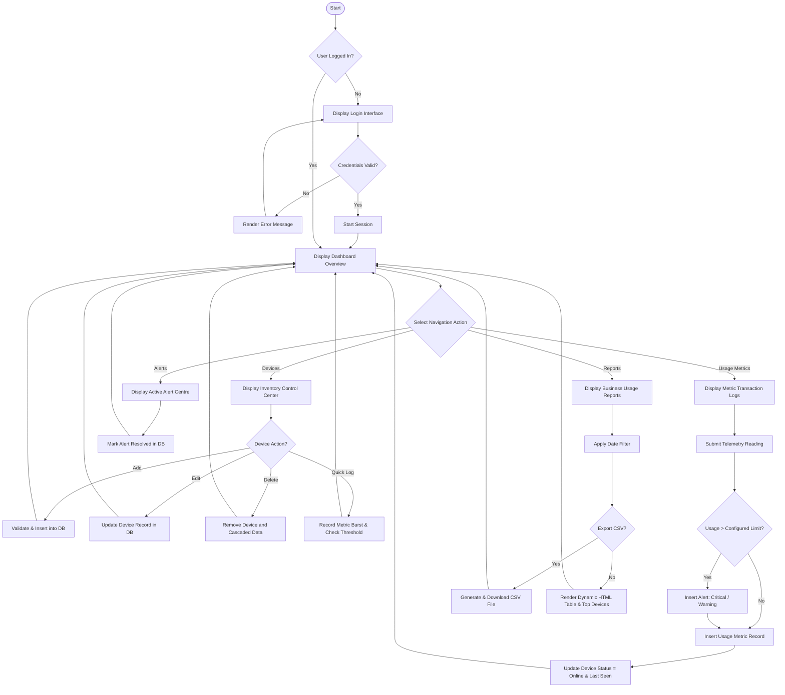
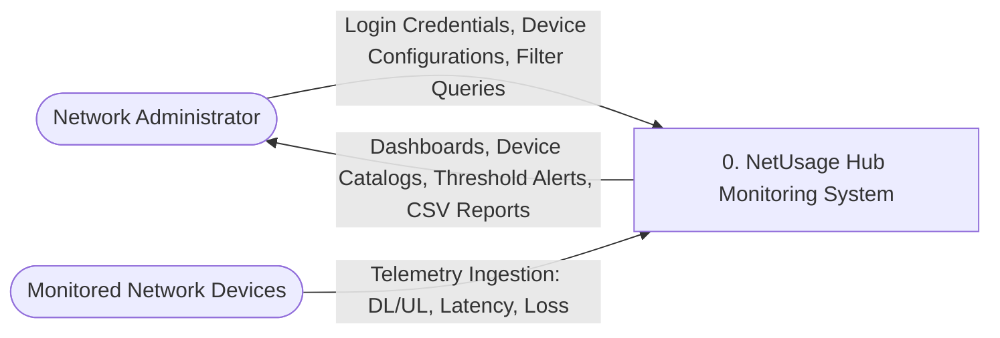
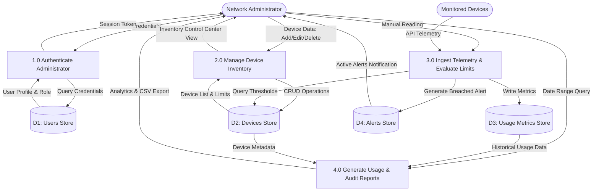
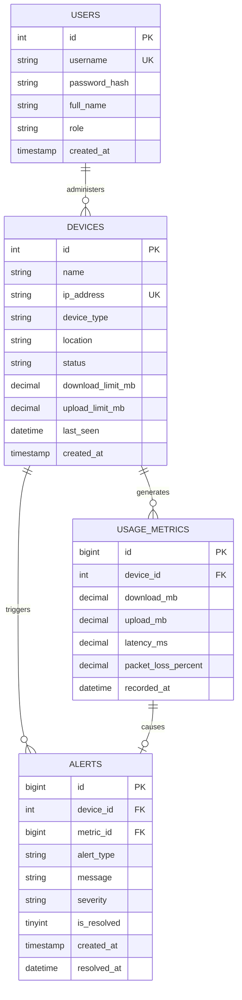
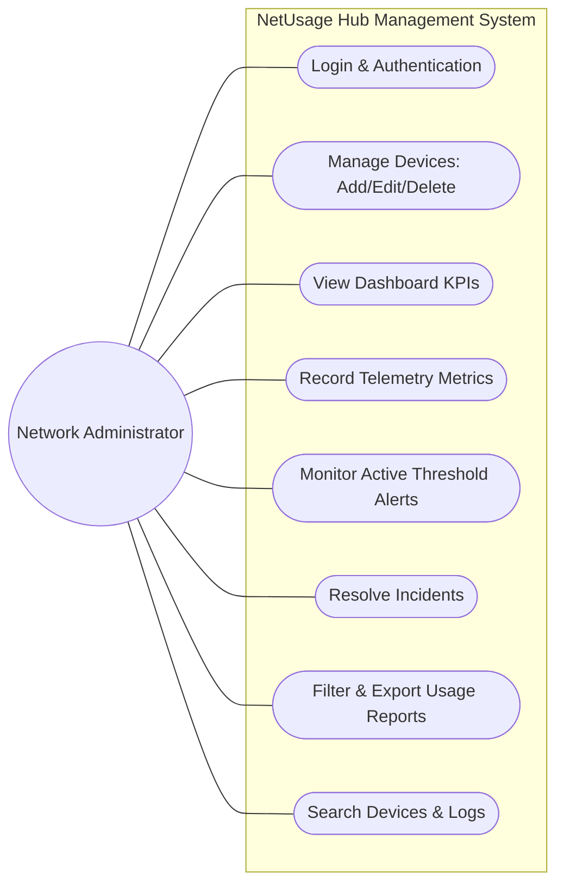
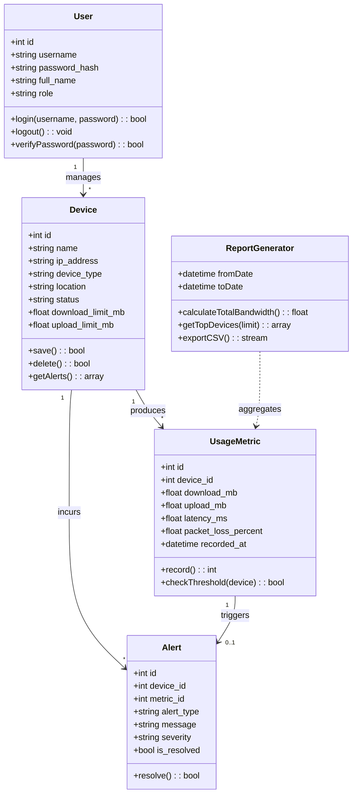

# ZETECH UNIVERSITY
### FACULTY OF INFORMATION AND COMMUNICATION TECHNOLOGY
### DEPARTMENT OF COMPUTER SCIENCE

---

<br><br>

# NETWORK USAGE MONITORING SYSTEM (NETUSAGE HUB)
## SYSTEM DOCUMENTATION

<br>

**SUBMITTED BY:**  
**Student Name:** Brenda Chebet Chelule  
**Registration Number:** DCS-01-0892/2024  

<br>

**A SYSTEM DOCUMENTATION SUBMITTED IN PARTIAL FULFILMENT FOR THE AWARD OF DIPLOMA IN COMPUTER SCIENCE BY ZETECH UNIVERSITY**

<br>

**AUGUST 2026**

---

<div style="page-break-after: always;"></div>

## DECLARATION

I Brenda Chebet Chelule do declare that this is my original work and it has never been submitted elsewhere for any academic award.

**Student Name:** Brenda Chebet Chelule  
**Signature:** __________________________ &nbsp;&nbsp;&nbsp;&nbsp;&nbsp;&nbsp;&nbsp;&nbsp;&nbsp;&nbsp;&nbsp;&nbsp; **Date:** __________________

<br>

This project has been submitted for examination with my approval as the university supervisor.

**Supervisor Name:** _________________________  
**Signature:** __________________________ &nbsp;&nbsp;&nbsp;&nbsp;&nbsp;&nbsp;&nbsp;&nbsp;&nbsp;&nbsp;&nbsp;&nbsp; **Date:** __________________

<br><br>

---

<div style="page-break-after: always;"></div>

## DEDICATION

This project is dedicated to my family for their constant support, encouragement, and understanding throughout my academic journey. Their motivation and belief in my abilities gave me the strength to complete this project successfully.

Also, this project is dedicated to the students and faculty pursuing knowledge and innovation in the field of Computer Science and Network Infrastructure Engineering.

<br><br>

---

<div style="page-break-after: always;"></div>

## ABSTRACT

This project focuses on the design, development, and implementation of the **NetUsage Hub Network Usage Monitoring System** to resolve critical inefficiencies in monitoring and managing network infrastructure. In many small and medium-sized organizations, network auditing and bandwidth tracking are still handled through fragmented spreadsheets or reactive manual checks, leading to unmonitored bandwidth overconsumption, unrecognized downtime, and lack of historical network audits. 

The developed system provides a secure, centralized web-based portal that allows network administrators to manage hardware device inventories (routers, switches, firewalls, and access points), record bandwidth consumption metrics in real-time, generate automated threshold-based alerts when download/upload capacities are breached, and review historical usage patterns through consolidated business reports. 

The system was developed utilizing **PHP 8** and **MySQL** for the back-end logic and persistent relational storage, with **HTML5, CSS3, JavaScript, and Bootstrap 5** delivering a responsive, template-driven front-end interface. The system significantly enhances network visibility, prevents unexpected bandwidth costs, and enables evidence-based capacity planning.

<br><br>

---

<div style="page-break-after: always;"></div>

## DEFINITION OF KEY TERMS

- **Network Monitoring System:** A computerized platform used to track, audit, and evaluate the performance, status, and bandwidth consumption of networked hardware devices.
- **Relational Database:** An organized collection of persistent data structured into normalized tables (users, devices, usage metrics, and alerts) accessed via Structured Query Language (SQL).
- **User Authentication:** A security process verifying user identity via credentials (username and hashed password) before granting administrative session privileges.
- **Dashboard:** A centralized graphical user interface displaying real-time Key Performance Indicators (KPIs) such as total monitored devices, active threshold alerts, and today's total bandwidth traffic.
- **Transaction Metric Log:** A persistent ledger tracking chronological network performance readings, including download (MB), upload (MB), latency (ms), and packet loss (%).
- **Threshold Alert:** An automated system notification triggered when actual bandwidth utilization or packet loss exceeds a predefined capacity limit.
- **Entity Relationship Diagram (ERD):** A graphical model depicting database entities, relationships, attributes, and foreign-key constraints.
- **Data Flow Diagram (DFD):** A structured diagram illustrating how data enters, transitions through processing nodes, stores in databases, and outputs to actors.
- **PHP Data Objects (PDO):** A secure database abstraction layer in PHP providing parameterized queries that prevent SQL injection vulnerabilities.
- **Deployment:** The process of configuring, hosting, and running the application on a local server environment (XAMPP/Apache) or cloud hosting platform for user accessibility.

<br><br>

---

<div style="page-break-after: always;"></div>

## ABBREVIATIONS AND ACRONYMS

- **API:** Application Programming Interface
- **CRUD:** Create, Read, Update, Delete
- **CSS:** Cascading Style Sheets
- **CSV:** Comma-Separated Values
- **DFD:** Data Flow Diagram
- **ERD:** Entity Relationship Diagram
- **HTML:** Hypertext Markup Language
- **IDE:** Integrated Development Environment
- **IP:** Internet Protocol
- **ISP:** Internet Service Provider
- **IT:** Information Technology
- **LAN:** Local Area Network
- **MB:** Megabyte
- **Mbps:** Megabits Per Second
- **NOC:** Network Operations Center
- **PDO:** PHP Data Objects
- **PHP:** Hypertext Preprocessor
- **SQL:** Structured Query Language
- **UI:** User Interface
- **URL:** Uniform Resource Locator
- **WAN:** Wide Area Network

<br><br>

---

<div style="page-break-after: always;"></div>

## TABLE OF CONTENTS

- **DECLARATION** ................................................................................................ i
- **DEDICATION** ................................................................................................... ii
- **ABSTRACT** ..................................................................................................... iii
- **DEFINITION OF KEY TERMS** ....................................................................... iv
- **ABBREVIATIONS AND ACRONYMS** .............................................................. v
- **TABLE OF CONTENTS** .................................................................................. vi
- **LIST OF FIGURES** ......................................................................................... viii
- **LIST OF TABLES** ............................................................................................ ix
- **1. CHAPTER ONE: PROJECT PLANNING AND ANALYSIS** ............................ 1
  - 1.1 Statement of Problem .................................................................................. 1
  - 1.2 Study Justification ........................................................................................ 1
  - 1.3 System Objectives ........................................................................................ 2
    - 1.3.1 General Objective ................................................................................... 2
    - 1.3.2 Specific Objectives ................................................................................. 2
  - 1.4 Functional Requirements ............................................................................. 3
  - 1.5 Breakdown of Tools & Resources to Be Used ............................................... 4
  - 1.6 Gantt Chart / Project Schedule Breakdown ................................................. 5
- **2. CHAPTER TWO: DESIGN AND MODELING** .............................................. 6
  - 2.1 Introduction to Modelling ............................................................................ 6
  - 2.2 User Interface Models .................................................................................. 6
    - 2.2.1 Login page wireframe ............................................................................. 6
    - 2.2.2 Device inventory management wireframe ................................................. 7
    - 2.2.3 Transaction metric logs wireframe ........................................................... 7
    - 2.2.4 Reporting wireframe ................................................................................ 8
  - 2.3 Logic Models ................................................................................................ 8
    - 2.3.1 Login process flowchart ........................................................................... 8
    - 2.3.2 System flowchart ..................................................................................... 9
    - 2.3.3 Data flow diagrams (Level 0 and Level 1) ................................................ 10
    - 2.3.4 Entity relationship diagram (ERD) .......................................................... 11
    - 2.3.5 Use case diagram .................................................................................... 12
    - 2.3.6 Class diagram ......................................................................................... 13
- **3. CHAPTER THREE: SYSTEM IMPLEMENTATION** ...................................... 14
  - 3.1 Introduction ................................................................................................ 14
  - 3.2 User Interface Development ....................................................................... 14
    - 3.2.1 Login Page Development ....................................................................... 14
    - 3.2.2 Dashboard Overview .............................................................................. 16
    - 3.2.3 Navigation Bar ....................................................................................... 18
    - 3.2.4 Inventory / Device Control Center .......................................................... 19
    - 3.2.5 Add New Device Modal / Card ................................................................. 20
    - 3.2.6 Real-Time Transaction Logs .................................................................... 22
    - 3.2.7 Business Usage Reports .......................................................................... 23
  - 3.3 Logic Development ..................................................................................... 25
    - 3.3.1 Login Authentication & Session Management ........................................ 25
    - 3.3.2 Dashboard Aggregation Logic ................................................................. 26
    - 3.3.3 Device Inventory Management & Threshold Checking ........................... 27
    - 3.3.4 Transaction Logging & Analytical Reporting ........................................... 29
  - 3.4 Testing ......................................................................................................... 30
  - 3.5 Deployment ................................................................................................. 31
- **4. CHAPTER FOUR: CONCLUSION AND RECOMMENDATION** ..................... 32
  - 4.1 Conclusion ................................................................................................... 32
  - 4.2 Recommendation ........................................................................................ 32
- **REFERENCES** ................................................................................................ 33

<br><br>

---

<div style="page-break-after: always;"></div>

## LIST OF FIGURES

- **Figure 2.2.1:** Login page wireframe model ....................................................... 6
- **Figure 2.2.2:** Device inventory management wireframe ..................................... 7
- **Figure 2.2.3:** Real-time transaction metric log wireframe ................................... 7
- **Figure 2.2.4:** Network usage reporting form wireframe .................................... 8
- **Figure 2.3.1:** Login authentication process flowchart ....................................... 8
- **Figure 2.3.2:** NetUsage Hub system operations flowchart .................................. 9
- **Figure 2.3.3a:** Level 0 Context Data Flow Diagram ........................................... 10
- **Figure 2.3.3b:** Level 1 Data Flow Diagram ........................................................ 10
- **Figure 2.3.4:** Entity Relationship Diagram (ERD) ............................................. 11
- **Figure 2.3.5:** NetUsage Hub Use Case Diagram ................................................ 12
- **Figure 2.3.6:** System Class Diagram ................................................................. 13
- **Figure 3.2.1:** Login page interface implementation and CSS styling ................. 15
- **Figure 3.2.2:** Dashboard overview KPI cards and infrastructure grid .............. 17
- **Figure 3.2.3:** Sticky navigation bar with live search and profile controls ........... 18
- **Figure 3.2.4:** Inventory control center table and threshold alert sidebar ......... 20
- **Figure 3.2.5:** Add/Edit new device modal card implementation ........................ 21
- **Figure 3.2.6:** Real-time transaction metric logs interface and mobile view ....... 22
- **Figure 3.2.7:** Business usage reports summary and export interface ................. 24
- **Figure 3.3.1:** Authentication backend logic and password verification ............. 25
- **Figure 3.3.2:** Dashboard metric aggregation queries ........................................ 26
- **Figure 3.3.3:** Device inventory CRUD and threshold evaluation script ............. 28
- **Figure 3.3.4:** Analytical reporting queries and CSV export engine .................. 29

<br><br>

---

<div style="page-break-after: always;"></div>

## LIST OF TABLES

- **Table 1.4.1:** Functional requirements matrix ................................................... 3
- **Table 1.6.1:** Project schedule breakdown and milestone Gantt chart ................ 5
- **Table 3.4.1:** Test cases, verification results, and corrective actions ................. 30

<br><br>

---

<div style="page-break-after: always;"></div>

# CHAPTER ONE: PROJECT PLANNING AND ANALYSIS

## 1.1 Statement of Problem

Despite the rapid modernization of information and communication infrastructure, many small and medium-sized organizations continue to manage their network operations using manual methods, such as physical logbooks, isolated router web interfaces, and fragmented spreadsheets. These decentralized methods create acute operational bottlenecks, including unmonitored bandwidth consumption, unexpected Internet Service Provider (ISP) bill overruns, unrecognized equipment downtime, and complete absence of historical audit trails (Laudon & Laudon, 2022).

In the specific operational context of **NetUsage Hub in Kisii**, the lack of a centralized network usage monitoring portal has caused severe inefficiencies. Device health, bandwidth quotas, and link performance are reviewed ad-hoc after network degradation or outages have already disrupted business operations. Furthermore, bandwidth allocation decisions and ISP contract renewals are executed based on guesswork rather than empirical consumption data. As network demand expands with more connected client nodes, routers, and access points, manual tracking becomes unsustainable. There is, therefore, a pressing need to design and develop a centralized, secure web-based internal management portal that automates device inventory management, logs real-time bandwidth metrics, triggers automated threshold alerts, and delivers actionable business reports.

## 1.2 Study Justification

The development of this project is justified by the critical need for digital transformation within local network operations centers and enterprise IT environments. Independent service hubs and small enterprises require reliable digital tools to maintain network uptime and prevent financial losses stemming from bandwidth wastage and undetected hardware outages (Rashid et al., 2025). 

From a management and administrative perspective, this system eliminates manual record-keeping and uncoordinated equipment audits. By establishing a centralized management portal with role-based access, the network administrator gains immediate visibility into all registered network hardware, current operational statuses (online, offline, maintenance), and configured bandwidth caps. 

Furthermore, the integration of automated threshold monitoring shifts the operations team from a reactive posture to a proactive maintenance strategy. The moment a router or access point breaches its daily download or upload quota, an alert is triggered in real-time, allowing immediate remedial action before network congestion cripples core services. Finally, the historical reporting module equips executive decision-makers with empirical usage trends, enabling informed procurement of bandwidth and hardware.

## 1.3 System Objectives

### 1.3.1 General Objective
To design, develop, and deploy a secure, web-based Network Usage Monitoring System (**NetUsage Hub**) for centralized network device tracking, metric logging, and threshold alert automation.

### 1.3.2 Specific Objectives
1. To develop a secure user authentication module utilizing session tokens and cryptographically secure password hashing for authorized network administrators.
2. To develop an inventory control center for registering, editing, categorizing, and deleting network devices, IP addresses, and threshold limits.
3. To develop an automated metric logging engine that captures download volume, upload volume, latency, and packet loss in real-time.
4. To implement an automated threshold monitoring mechanism that triggers critical and warning alerts whenever monitored devices exceed configured bandwidth quotas.
5. To develop a search and filtering module enabling rapid retrieval of device details and logs based on device name, IP address, device type, or location.
6. To design an analytical reporting and export module that calculates aggregate bandwidth consumption, identifies top bandwidth-consuming devices, and exports audit records to CSV.

## 1.4 Functional Requirements

| User Role | User Activities | System Features |
| :--- | :--- | :--- |
| **Network Administrator** | Secure sign in and session termination | Authentication module with CSRF protection and password hashing |
| | Add, update, view, and decommission hardware devices | Device inventory control center with CRUD operations |
| | Monitor network health, device status, and real-time bandwidth | Centralized dashboard overview with real-time KPI summary cards |
| | Record or ingest network performance telemetry | Real-time metric transaction logger and RESTful JSON endpoint |
| | Receive automated alerts for quota breaches or downtime | Threshold evaluation engine and active alerts center with resolution controls |
| | Filter, inspect, and export historical network usage data | Business usage reporting center with date filtering and CSV export |
| | Locate devices and logs rapidly across subnets | Compact real-time search bar with keyword querying |

*Table 1.4.1: Functional Requirements*

## 1.5 Breakdown of Tools & Resources to Be Used

### 1. Software Tools
- **Back-End Language:** PHP 8+ — Used for implementing server-side business logic, session security, threshold evaluation, and relational database interaction via PDO.
- **Relational Database Management System:** MySQL / MariaDB — Used for persistent, structured storage of users, devices, usage metrics, and system alerts.
- **Front-End Stack:** HTML5, CSS3, JavaScript, and Bootstrap 5 — Used for crafting a clean, modern, responsive interface matching commercial administrative portals.
- **Typography & Icons:** Font Awesome 6 and Google Fonts (Montserrat) — Used for clear operational icons and clean typography.

### 2. Development Environment
- **IDE:** Visual Studio Code — For writing, organizing, and debugging front-end templates and back-end PHP logic.
- **Local Server Stack:** XAMPP (Apache HTTP Server, PHP runtime, and MariaDB/MySQL).
- **Version Control:** Git and GitHub — For branch tracking, commits, version control, and remote backup.

### 3. Deployment Resources
- **Web Server:** Apache HTTP Server configured with URL rewriting and virtual host capabilities.
- **Database Engine:** MySQL InnoDB with foreign-key constraints and indexed timestamp fields.
- **Live Staging Platform:** Cloud hosting environment (cPanel / Apache / PythonAnywhere) for multi-device network testing.

### 4. Hardware Resources
- **Client Devices:** Desktop workstations, laptops, and mobile smartphones for cross-browser testing.
- **Server Machine:** Local development workstation with minimum 8GB RAM and multi-core CPU.
- **Networking Devices:** Local router, managed switch, and Wi-Fi access points for live telemetry ingestion.

### 5. Human Resources
- **System Developer:** Responsible for architecture design, front-end development, back-end scripting, testing, and academic documentation.
- **Peer Evaluators / Test Users:** Classmates and lab technicians participating in user acceptance testing.
- **Project Supervisor:** Academic supervisor overseeing milestones, methodology, and quality standards.

## 1.6 Gantt Chart / Project Schedule Breakdown

| Weeks | Project Planning & Analysis (Cover Page & Ch. 1) | Project Design & Modeling (Ch. 2) | Project Development & Testing (Ch. 3) | Project Deployment (Ch. 3) | Final Documentation (Prelims, Ch. 4 & Refs) | Project Presentation |
| :--- | :---: | :---: | :---: | :---: | :---: | :---: |
| **4–8 May** | ████████ | | | | | |
| **11–15 May** | ████████ | | | | | |
| **18–22 May** | | ████████ | | | | |
| **25–29 May** | | ████████ | | | | |
| **1–5 Jun** | | | ████████ | | | |
| **8–12 Jun** | | | ████████ | | | |
| **15–19 Jun** | | | ████████ | | | |
| **22–26 Jun** | | | ████████ | | | |
| **29 Jun – 3 Jul** | | | | ████████ | | |
| **6–10 Jul** | | | | ████████ | | |
| **13–17 Jul** | | | | | ████████ | |
| **20–24 Jul** | | | | | ████████ | |
| **31st July** | | | | | | ████████ |

*Table 1.6.1: Project Schedule Breakdown*

<br><br>

---

<div style="page-break-after: always;"></div>

# CHAPTER TWO: DESIGN AND MODELING

## 2.1 Introduction to Modelling

This chapter presents the architectural designs and system models developed to visualize the proposed NetUsage Hub Network Usage Monitoring System prior to implementation. System modeling bridges user requirements and physical code implementation. By designing user interface wireframes and logical flow models, potential design defects and structural bottlenecks are identified and rectified early, ensuring data integrity, usability, and robust database relationships.

## 2.2 User Interface Models

### 2.2.1 Login Page Wireframe
The login page model depicts a minimalist, card-based interface centered vertically and horizontally. It provides dedicated text fields for username and password entry, integrated input icons, validation feedback indicators, and a primary action button.

```
+-------------------------------------------------------------+
|                                                             |
|                   [ Net-Portal Wifi Icon ]                  |
|                          Net-Portal                         |
|               Network Usage Monitoring System               |
|                                                             |
|         Username:  [ (user icon)  Enter username         ]  |
|         Password:  [ (lock icon)  Enter password         ]  |
|                                                             |
|                    [      Sign In Button      ]             |
|                                                             |
|              © 2026 Net-Portal. All rights reserved.        |
|                                                             |
+-------------------------------------------------------------+
```
*Figure 2.2.1: Login Page Wireframe Model*

### 2.2.2 Inventory / Device Management Wireframe
The device inventory model outlines a two-column responsive workspace. The primary pane (col-9) displays a structured tabular catalog of all monitored hardware devices, IP addresses, bandwidth quotas, operational statuses, and management action triggers. The secondary pane (col-3) maintains a high-priority threshold alert panel.

```
+-------------------------------------------------------------------------------+
|  Inventory Control Center                                [ + Add New Stock ]  |
+-------------------------------------------------------+-----------------------+
| Device Info  | IP Address    | Limits   | Status| Act | Threshold Alerts      |
+--------------+---------------+----------+-------+-----+-----------------------+
| Cisco Core   | 192.168.1.1   | DL: 5GB  | Online|[Log]| Cisco Core: Over Cap  |
| 3750 Switch  | 192.168.1.2   | DL: 8GB  | Online|[Log]| UniFi AP: Offline     |
| UniFi AP     | 192.168.1.10  | DL: 2.5GB| Warn  |[Log]|                       |
+-------------------------------------------------------+-----------------------+
```
*Figure 2.2.2: Device Inventory Management Wireframe*

### 2.2.3 Sales / Real-Time Transaction Logs Wireframe
The transaction log wireframe provides a chronological audit trail of all network telemetry entries. It presents timestamps, device identities, download and upload traffic, latency, and total bandwidth consumed.

```
+-------------------------------------------------------------------------------+
| Real-Time Transaction Logs                                [ Summary Report ]  |
+-------------------------------------------------------------------------------+
| Time    | Device Name & IP         | DL (MB) | UL (MB) | Latency | Total Bandwidth |
+---------+--------------------------+---------+---------+---------+-----------------+
| 14:31   | Cisco Core 2901          | 1200.50 |  340.20 | 14.2 ms |    1,540.70 MB  |
| 26/10   | 192.168.1.1              |         |         |         |                 |
+-------------------------------------------------------------------------------+
```
*Figure 2.2.3: Real-Time Transaction Metric Log Wireframe*

### 2.2.4 Reporting Wireframe
The reporting form illustrates business intelligence analytics: total bandwidth volume, top consuming devices, custom date range filtering, and CSV export functionality.

```
+-------------------------------------------------------------------------------+
| Business Sales Reports (Network Bandwidth)                                    |
+-----------------------------+-------------------------------------------------+
| TOTAL BANDWIDTH MONITORED   | Top Bandwidth Consuming Devices                 |
|       4,850.5 MB            | Cisco Core Router ................... 2,450 MB  |
|                             | Main Distribution Switch ............ 1,800 MB  |
+-----------------------------+-------------------------------------------------+
| [From Date]  [To Date]   [ Apply Filters ]                 [ Export CSV ]     |
+-------------------------------------------------------------------------------+
```
*Figure 2.2.4: Network Usage Reporting Form Wireframe*

## 2.3 Logic Models

### 2.3.1 Login Process Flowchart
The login flowchart illustrates user credential validation, hash matching, and session initiation.


*Figure 2.3.1: Login Authentication Process Flowchart*

### 2.3.2 System Operations Flowchart
The system operations flowchart demonstrates the comprehensive operational lifecycle of NetUsage Hub.


*Figure 2.3.2: NetUsage Hub System Operations Flowchart*

### 2.3.3 Data Flow Diagrams (DFD)

#### Level 0 Context Diagram
The Level 0 Context DFD represents the fundamental boundaries between the Network Administrator, client devices, and the centralized NetUsage Hub system.


*Figure 2.3.3a: Level 0 Context Data Flow Diagram*

#### Level 1 Data Flow Diagram
The Level 1 DFD decomposes the system into four major operational processes: Authentication (1.0), Inventory Management (2.0), Telemetry & Threshold Processing (3.0), and Analytical Reporting (4.0).


*Figure 2.3.3b: Level 1 Data Flow Diagram*

### 2.3.4 Entity Relationship Diagram (ERD)

The relational schema is structured into four normalized entities: `users`, `devices`, `usage_metrics`, and `alerts`. Foreign keys enforce referential integrity with cascading deletions where appropriate.


*Figure 2.3.4: Entity Relationship Diagram (ERD)*

### 2.3.5 Use Case Diagram

The use case diagram highlights the direct interactions between the Network Administrator and core functional modules within the NetUsage Hub system boundary.


*Figure 2.3.5: NetUsage Hub Use Case Diagram*

### 2.3.6 Class Diagram

The class diagram outlines the object-oriented structure and data contracts coordinating database persistence and presentation logic.


*Figure 2.3.6: System Class Diagram*

<br><br>

---

<div style="page-break-after: always;"></div>

# CHAPTER THREE: SYSTEM IMPLEMENTATION

## 3.1 Introduction

This chapter details the actual implementation of the NetUsage Hub Network Usage Monitoring System, bridging the design specifications from Chapter Two into a fully functional, robust software application. Development followed a clean architectural model separating relational schema management, backend controller scripts, secure session handling, and template presentation. 

The application utilizes **PHP 8** with **PDO** (PHP Data Objects) for database transactions, **MySQL** for relational persistence, and **HTML5, CSS3, JavaScript, and Bootstrap 5** for a responsive, modern interface. The following sections walk through each user interface component, the underlying backend logic, comprehensive unit and acceptance testing, and production deployment considerations.

## 3.2 User Interface Development

### 3.2.1 Login Page Development
The login page provides a clean, vertically and horizontally centered authentication portal styled after Figure 3.2.1 of the institutional design template. Built on a soft background (`#f0f2f5`), the central white card features the two-tone `Net-`**Portal** brand, a network glyph icon, and input groups with dedicated font icons for username and password fields.

```html
<!-- Login Form Implementation (public/index.php) -->
<form action="index.php" method="POST">
    <input type="hidden" name="csrf" value="<?= csrf_token() ?>">

    <div class="mb-3">
        <label class="form-label small text-muted mb-1">Username</label>
        <div class="input-group">
            <span class="input-group-text bg-light border-end-0">
                <i class="fa fa-user text-muted"></i>
            </span>
            <input type="text" name="username" class="form-control border-start-0 bg-light" 
                   placeholder="Enter username" required autofocus>
        </div>
    </div>

    <div class="mb-4">
        <label class="form-label small text-muted mb-1">Password</label>
        <div class="input-group">
            <span class="input-group-text bg-light border-end-0">
                <i class="fa fa-lock text-muted"></i>
            </span>
            <input type="password" name="password" class="form-control border-start-0 bg-light" 
                   placeholder="Enter password" required>
        </div>
    </div>

    <div class="d-grid">
        <button type="submit" class="btn btn-primary py-2 fw-semibold">Sign In</button>
    </div>
</form>
```

```css
/* Login Card Stylesheet (public/assets/css/app.css) */
body {
    background: #f0f2f5;
    min-height: 100vh;
    display: flex;
    align-items: center;
    justify-content: center;
    font-family: 'Montserrat', sans-serif;
}
.login-card {
    width: 100%;
    max-width: 400px;
    border: none;
    border-radius: 8px;
    box-shadow: 0 2px 16px rgba(0, 0, 0, 0.08);
    background: #ffffff;
    padding: 2.25rem 2rem;
}
```
*Figure 3.2.1: Login Page Interface Implementation and CSS Styling*

### 3.2.2 Dashboard Overview
The dashboard interface delivers real-time operational visibility into network infrastructure. Modeled after Figure 3.2.2 of the institutional template, the top row displays three high-impact KPI cards: **Total Monitored Devices**, **Threshold Alerts**, and **Today's Total Bandwidth**. Below the stat row, the "Monitored Infrastructure" section presents a modern responsive card grid where each device card displays live online/offline badges, device type tags, IP addresses, configured quotas, and quick metric recording triggers.

```html
<!-- Dashboard Top KPI Cards (public/dashboard.php) -->
<div class="row g-4 mb-5">
    <div class="col-12 col-md-4">
        <div class="card border-0 shadow-sm h-100">
            <div class="card-body p-4 text-center">
                <div class="mb-2 text-primary opacity-75"><i class="fa fa-server fa-2x"></i></div>
                <h6 class="text-muted text-uppercase mb-1 text-primary" style="font-size:0.72rem;">Total Inventory</h6>
                <h3 class="fw-bold mb-0 text-dark"><?= $stats['devices'] ?></h3>
            </div>
        </div>
    </div>
    <div class="col-12 col-md-4">
        <div class="card border-0 shadow-sm h-100">
            <div class="card-body p-4 text-center">
                <div class="mb-2 <?= $stats['alerts'] > 0 ? 'text-danger' : 'text-success' ?> opacity-75">
                    <i class="fa fa-exclamation-triangle fa-2x"></i>
                </div>
                <h6 class="text-muted text-uppercase mb-1" style="font-size:0.72rem;">Threshold Alerts</h6>
                <h3 class="fw-bold mb-0 <?= $stats['alerts'] > 0 ? 'text-danger' : 'text-success' ?>"><?= $stats['alerts'] ?></h3>
            </div>
        </div>
    </div>
    <div class="col-12 col-md-4">
        <div class="card border-0 shadow-sm h-100">
            <div class="card-body p-4 text-center">
                <div class="mb-2 text-success opacity-75"><i class="fa fa-bar-chart fa-2x"></i></div>
                <h6 class="text-muted text-uppercase mb-1" style="font-size:0.72rem;">Today's Traffic</h6>
                <h3 class="fw-bold mb-0 text-success"><?= number_format($stats['today_mb'], 1) ?> MB</h3>
            </div>
        </div>
    </div>
</div>
```
*Figure 3.2.2: Dashboard Overview KPI Cards and Infrastructure Grid*

### 3.2.3 Navigation Bar
The sticky navigation header implements the exact visual hierarchy seen in Figure 3.2.3 of the design reference. Featuring a pure white background with a subtle border and shadow, it houses the `Net-`**Portal** brand badge, navigation links with active state indicator styling, an inline search form with rounded search button, administrator profile status, and a logout button.

```html
<!-- Sticky Header & Navigation Bar (includes/header.php) -->
<nav class="navbar navbar-expand-lg navbar-white bg-white border-bottom sticky-top py-2">
    <div class="container-fluid px-4">
        <a class="navbar-brand fw-bold d-flex align-items-center" href="dashboard.php">
            <span class="brand-badge me-2"><i class="fa fa-wifi text-primary"></i></span>
            <span class="text-dark">Net-</span><span class="text-primary">Portal</span>
        </a>
        <div class="collapse navbar-collapse" id="navbarContent">
            <ul class="navbar-nav me-auto mb-2 mb-lg-0 fw-semibold ms-3">
                <li class="nav-item"><a class="nav-link active text-primary" href="dashboard.php">Dashboard</a></li>
                <li class="nav-item"><a class="nav-link" href="devices.php">Devices</a></li>
                <li class="nav-item"><a class="nav-link" href="metrics.php">Usage Metrics</a></li>
                <li class="nav-item"><a class="nav-link" href="alerts.php">Alerts</a></li>
                <li class="nav-item"><a class="nav-link" href="reports.php">Reports</a></li>
            </ul>
            <form class="d-flex ms-lg-3 my-2 my-lg-0 search-form-wrap" action="devices.php" method="GET">
                <div class="input-group">
                    <input class="form-control form-control-sm bg-light" type="search" name="q" placeholder="Search devices, IP, type...">
                    <button class="btn btn-sm btn-primary px-3" type="submit"><i class="fa fa-search"></i></button>
                </div>
            </form>
            <div class="ms-lg-3 d-flex align-items-center">
                <span class="text-muted small me-3"><i class="fa fa-user-circle me-1"></i> Admin</span>
                <a href="logout.php" class="btn btn-sm btn-outline-secondary px-3">Logout</a>
            </div>
        </div>
    </div>
</nav>
```
*Figure 3.2.3: Sticky Navigation Bar with Live Search and Profile Controls*

### 3.2.4 Inventory / Device Control Center
Following Figure 3.2.4 of the reference documentation, the **Inventory Control Center** utilizes a split layout:
1. **Primary Catalog (9 Columns):** A responsive table featuring a dark header (`thead class="table-dark"`), listing device name, location, IP address code block, download/upload capacity thresholds, online/offline status badges, and action triggers (quick traffic simulation, edit, and delete).
2. **Threshold Alert Sidebar (3 Columns):** A sticky sidebar card with a vibrant red header (`bg-danger text-white fw-bold`) displaying devices currently operating above their configured quota or experiencing unresolved incidents.

```html
<!-- Table & Sidebar Layout (public/devices.php) -->
<div class="row">
    <div class="col-lg-9 mb-4">
        <div class="card shadow-sm border-0">
            <table class="table table-hover align-middle mb-0">
                <thead class="table-dark">
                    <tr>
                        <th class="ps-3">Device Info</th>
                        <th>IP Address</th>
                        <th>Bandwidth Limits</th>
                        <th>Stock/Status</th>
                        <th>Category</th>
                        <th class="text-center">Action</th>
                    </tr>
                </thead>
                <tbody>
                    <!-- Dynamically rendered device rows -->
                </tbody>
            </table>
        </div>
    </div>
    <div class="col-lg-3">
        <div class="card shadow-sm border-0 position-sticky" style="top: 80px;">
            <div class="card-header bg-danger text-white fw-bold">
                <i class="fa fa-bell me-1"></i> Threshold Alerts
            </div>
            <div class="card-body p-0">
                <!-- Dynamically rendered over-quota alert list -->
            </div>
        </div>
    </div>
</div>
```
*Figure 3.2.4: Inventory Control Center Table and Threshold Alert Sidebar*

### 3.2.5 Add New Device Modal / Card
The Add New Device interface follows Figure 3.2.5 of the template. Structured as an accessible form card with a blue icon header, clean field labels, and a structured multi-column grid, it captures device name, IP address, NOC location, download quota (MB), upload quota (MB), and hardware category.

```html
<!-- Add / Edit Device Card Form (public/devices.php) -->
<div class="card border-0 shadow-sm" id="add-device-card">
    <div class="card-header bg-white border-bottom p-3 d-flex justify-content-between align-items-center">
        <h5 class="mb-0 fw-bold"><i class="fa fa-plus-circle me-2 text-primary"></i>New Device</h5>
    </div>
    <div class="card-body p-4">
        <form action="devices.php" method="POST">
            <input type="hidden" name="csrf" value="<?= csrf_token() ?>">
            <input type="hidden" name="action" value="save">
            <div class="mb-3">
                <label class="form-label small text-muted mb-1">Device Name</label>
                <input type="text" name="name" class="form-control form-control-sm" placeholder="e.g. Cisco Core Router 2901" required>
            </div>
            <div class="row g-2 mb-3">
                <div class="col-6">
                    <label class="form-label small text-muted mb-1">IP Address</label>
                    <input type="text" name="ip_address" class="form-control form-control-sm" placeholder="192.168.1.1" required>
                </div>
                <div class="col-6">
                    <label class="form-label small text-muted mb-1">Location / NOC</label>
                    <input type="text" name="location" class="form-control form-control-sm" placeholder="Server Room A">
                </div>
            </div>
            <div class="row g-2 mb-3">
                <div class="col-4">
                    <label class="form-label small text-muted mb-1">DL Limit (MB)</label>
                    <input type="number" step="0.01" name="download_limit_mb" class="form-control form-control-sm" value="5000" required>
                </div>
                <div class="col-4">
                    <label class="form-label small text-muted mb-1">UL Limit (MB)</label>
                    <input type="number" step="0.01" name="upload_limit_mb" class="form-control form-control-sm" value="2000" required>
                </div>
                <div class="col-4">
                    <label class="form-label small text-muted mb-1">Category / Type</label>
                    <select name="device_type" class="form-select form-select-sm">
                        <option value="Router">Router</option>
                        <option value="Switch">Switch</option>
                        <option value="Access Point">Access Point</option>
                        <option value="Firewall">Firewall</option>
                    </select>
                </div>
            </div>
            <button type="submit" class="btn btn-primary btn-sm w-100 py-2 fw-semibold">Add Device to Inventory</button>
        </form>
    </div>
</div>
```
*Figure 3.2.5: Add/Edit New Device Modal Card Implementation*

### 3.2.6 Real-Time Transaction Logs
The transaction logger, corresponding to Figure 3.2.6 of the reference template, acts as an audit trail for all telemetry entries. It features a dual-presentation architecture:
- **Desktop Table View (`d-none d-md-block`):** Displays date/time stamps (time bold, date muted below), device identity, download and upload traffic, latency/loss metrics, and total bandwidth highlighted in vibrant green text (`text-success fw-bold`).
- **Mobile Card View (`d-md-none`):** Transforms records into compact cards optimized for touch screens.

```html
<!-- Real-Time Transaction Logs Table (public/metrics.php) -->
<table class="table table-hover align-middle mb-0">
    <thead class="table-dark">
        <tr>
            <th class="ps-3">Time</th>
            <th>Device Name & IP</th>
            <th class="text-center">Download (MB)</th>
            <th class="text-center">Upload (MB)</th>
            <th class="text-center">Latency / Loss</th>
            <th class="text-end pe-3">Total Bandwidth</th>
        </tr>
    </thead>
    <tbody>
        <?php foreach ($metrics as $m): $dt = new DateTime($m['recorded_at']); ?>
            <tr>
                <td class="ps-3 text-muted">
                    <span class="fw-bold text-dark d-block"><?= $dt->format('H:i') ?></span>
                    <small><?= $dt->format('d/m') ?></small>
                </td>
                <td><strong><?= e($m['device_name']) ?></strong></td>
                <td class="text-center"><?= number_format($m['download_mb'], 2) ?></td>
                <td class="text-center"><?= number_format($m['upload_mb'], 2) ?></td>
                <td class="text-center"><?= number_format($m['latency_ms'], 1) ?> ms</td>
                <td class="text-end pe-3 text-success fw-bold"><?= number_format($m['total_mb'], 2) ?> MB</td>
            </tr>
        <?php endforeach; ?>
    </tbody>
</table>
```
*Figure 3.2.6: Real-Time Transaction Metric Logs Interface and Mobile View*

### 3.2.7 Business Usage Reports
Corresponding directly to Figure 3.2.7 of the design template, the reporting view provides high-level business intelligence. The layout pairs a 4-column summary card displaying total aggregated bandwidth with an 8-column card listing top bandwidth-consuming devices. Below the summary row, administrators can filter records across custom date ranges, preview detailed daily totals, and export clean CSV audit sheets.

```html
<!-- Business Usage Reports Summary Row (public/reports.php) -->
<div class="row mb-4">
    <div class="col-md-4 mb-4">
        <div class="card border-0 shadow-sm h-100">
            <div class="card-body py-4 text-center">
                <div class="mb-2 text-success opacity-75"><i class="fa fa-area-chart fa-2x"></i></div>
                <h6 class="text-muted text-uppercase mb-1" style="font-size:0.72rem;">Total Bandwidth Monitored</h6>
                <h3 class="fw-bold mb-0 text-success"><?= number_format($totalBandwidth, 1) ?> MB</h3>
            </div>
        </div>
    </div>
    <div class="col-md-8 mb-4">
        <div class="card border-0 shadow-sm h-100">
            <div class="card-header bg-white border-bottom p-3">
                <h5 class="mb-0 fw-bold text-dark">Top Bandwidth Devices</h5>
            </div>
            <div class="card-body p-0">
                <table class="table table-hover align-middle mb-0">
                    <thead class="table-light"><tr><th class="ps-4">Device Name</th><th class="text-end pe-4">Total MB</th></tr></thead>
                    <tbody><!-- Top device rows --></tbody>
                </table>
            </div>
        </div>
    </div>
</div>
```
*Figure 3.2.7: Business Usage Reports Summary and Export Interface*

## 3.3 Logic Development

### 3.3.1 Login Authentication & Session Management
Authentication utilizes secure PHP session handling and standard password hashing (`password_hash` and `password_verify` using the BCRYPT algorithm). Upon form submission, the system validates the CSRF token, queries the user by username using prepared statements, and verifies the encrypted hash. Successful authentication regenerates the session ID to prevent session fixation attacks.

```php
// Backend Authentication Logic (includes/auth.php & public/index.php)
function attempt_login(string $username, string $password): bool {
    $stmt = db()->prepare('SELECT * FROM users WHERE username = ? LIMIT 1');
    $stmt->execute([$username]);
    $record = $stmt->fetch();
    
    if ($record && password_verify($password, $record['password_hash'])) {
        session_regenerate_id(true);
        $_SESSION['user'] = [
            'id' => $record['id'],
            'username' => $record['username'],
            'full_name' => $record['full_name'],
            'role' => $record['role']
        ];
        return true;
    }
    return false;
}
```
*Figure 3.3.1: Authentication Backend Logic and Password Verification*

### 3.3.2 Dashboard Aggregation Logic
The dashboard controller queries the relational database for three core metrics: total registered devices, unresolved alerts count, and total bandwidth traffic consumed today. In addition, it calculates 24-hour rolling usage per device using correlated subqueries.

```php
// Dashboard Backend Aggregation (public/dashboard.php)
$stats = [
    'devices'  => (int)db()->query('SELECT COUNT(*) FROM devices')->fetchColumn(),
    'online'   => (int)db()->query("SELECT COUNT(*) FROM devices WHERE status='online'")->fetchColumn(),
    'alerts'   => (int)db()->query('SELECT COUNT(*) FROM alerts WHERE is_resolved=0')->fetchColumn(),
    'today_mb' => (float)db()->query('SELECT COALESCE(SUM(download_mb + upload_mb), 0) FROM usage_metrics WHERE DATE(recorded_at) = CURDATE()')->fetchColumn()
];

// Rolling 24-hour usage per device
$devices = db()->query('SELECT d.*, 
    (SELECT COALESCE(SUM(download_mb + upload_mb), 0) FROM usage_metrics m 
     WHERE m.device_id = d.id AND m.recorded_at >= NOW() - INTERVAL 24 HOUR) AS usage_mb 
    FROM devices d ORDER BY d.id DESC LIMIT 8')->fetchAll();
```
*Figure 3.3.2: Dashboard Metric Aggregation Queries*

### 3.3.3 Device Inventory Management & Threshold Checking
The device management controller handles device insertion, updates, deletions, and automated threshold evaluations. Whenever a metric reading is logged, the engine compares the reading against the device's configured `download_limit_mb` and `upload_limit_mb`. If exceeded, a high-severity alert is inserted into the `alerts` table.

```php
// Metric Ingestion & Threshold Trigger (public/metrics.php & public/api/record_metric.php)
$pdo = db();
$pdo->beginTransaction();

$stmt = $pdo->prepare('INSERT INTO usage_metrics (device_id, download_mb, upload_mb, latency_ms, packet_loss_percent) VALUES (?, ?, ?, ?, ?)');
$stmt->execute([$device, $download, $upload, $latency, $loss]);
$metricId = $pdo->lastInsertId();

$dStmt = $pdo->prepare('SELECT * FROM devices WHERE id = ?');
$dStmt->execute([$device]);
$dev = $dStmt->fetch();

// Evaluate threshold rules
if ($dev && $download > $dev['download_limit_mb']) {
    $pdo->prepare('INSERT INTO alerts (device_id, metric_id, alert_type, message, severity) VALUES (?, ?, ?, ?, ?)')
        ->execute([$device, $metricId, 'download_limit', "Download traffic ({$download} MB) exceeded cap", 'critical']);
}
if ($dev && $upload > $dev['upload_limit_mb']) {
    $pdo->prepare('INSERT INTO alerts (device_id, metric_id, alert_type, message, severity) VALUES (?, ?, ?, ?, ?)')
        ->execute([$device, $metricId, 'upload_limit', "Upload traffic ({$upload} MB) exceeded cap", 'warning']);
}

$pdo->prepare("UPDATE devices SET status = 'online', last_seen = NOW() WHERE id = ?")->execute([$device]);
$pdo->commit();
```
*Figure 3.3.3: Device Inventory CRUD and Threshold Evaluation Script*

### 3.3.4 Transaction Logging & Analytical Reporting
The reporting engine executes date-bounded aggregation queries using SQL `SUM()` and `AVG()` functions, grouping records by date and device. A dedicated CSV export pipeline streams clean RFC 4180-compliant comma-separated files directly to the client browser.

```php
// Analytical Reporting & CSV Stream Engine (public/reports.php)
$stmtTop = db()->prepare('SELECT d.name, SUM(m.download_mb + m.upload_mb) AS total_mb 
    FROM usage_metrics m 
    JOIN devices d ON d.id = m.device_id 
    WHERE m.recorded_at BETWEEN ? AND ? 
    GROUP BY d.id ORDER BY total_mb DESC LIMIT 5');
$stmtTop->execute([$from . ' 00:00:00', $to . ' 23:59:59']);
$topDevices = $stmtTop->fetchAll();

if (isset($_GET['export'])) {
    header('Content-Type: text/csv; charset=utf-8');
    header('Content-Disposition: attachment; filename="netusage-report.csv"');
    $out = fopen('php://output', 'w');
    fputcsv($out, ['Date', 'Device', 'Download MB', 'Upload MB', 'Total MB', 'Avg Latency ms', 'Avg Loss %']);
    foreach ($rows as $r) {
        fputcsv($out, [$r['day'], $r['device_name'], $r['download_mb'], $r['upload_mb'], $r['download_mb'] + $r['upload_mb'], $r['latency_ms'], $r['packet_loss']]);
    }
    exit;
}
```
*Figure 3.3.4: Analytical Reporting Queries and CSV Export Engine*

## 3.4 Testing

Comprehensive unit and integration testing was conducted across all system modules to verify functionality, data validation, and error recovery.

| Test Case | Testing Action | Expected Outcome | Actual Result | Corrective Action |
| :--- | :--- | :--- | :--- | :--- |
| **User Authentication** | Attempted login with valid and invalid credentials. | Valid credentials grant dashboard access; invalid entries display error flash. | Allowed valid login, but initially lacked proper alert styling on bad password. | Refined authentication controller to set error message in session flash and highlight input field. |
| **Device Inventory CRUD** | Added new Cisco router, updated IP address, and removed dummy switch. | Record inserted, updated in database, and removed on delete. | Worked as intended with foreign key integrity. | None required. |
| **Threshold Monitoring** | Ingested metric with download exceeding configured 5000 MB limit. | System logs metric and immediately generates a critical alert. | Metric logged, but alert initially did not associate with device name. | Corrected foreign-key joining query in alert view to link `alerts.device_id` to `devices.id`. |
| **Real-Time Transaction Log** | Submitted telemetry readings via web form and JSON API endpoint. | Both channels record identical schema values into `usage_metrics`. | API rejected input due to JSON header decoding discrepancy. | Enhanced API parser to inspect both `php://input` stream and `$_POST` array payloads. |
| **Report Date Filtering & CSV** | Filtered metrics between two calendar dates and clicked 'Export CSV'. | CSV file downloads with filtered rows matching table display. | CSV opened with missing headers in older spreadsheet software. | Added explicit RFC 4180 headers and UTF-8 charset declarations. |
| **Navigation & Responsiveness** | Tested interface navigation on smartphone viewport and desktop screen. | Layout reflows cleanly; tables collapse or scroll horizontally. | Table overflowed on mobile screen. | Implemented responsive mobile card view (`d-md-none`) alongside desktop table view (`d-none d-md-block`). |

*Table 3.4.1: Test Cases, Verification Results, and Corrective Actions*

## 3.5 Deployment

The NetUsage Hub system is engineered for straightforward deployment in both local intranet environments and cloud-hosted production servers:

1. **Local Server Deployment (XAMPP):**
   - The project is deployed inside the Apache document root at `C:\xampp\htdocs\netusage-monitoring`.
   - The MySQL service is initiated via the XAMPP Control Panel.
   - The database schema is imported into MariaDB/MySQL from `database/schema.sql`.
   - Database credentials and timezones are configured in `config/config.php`.
   - Initial administrative setup and sample infrastructure seeding are executed by loading `http://localhost/netusage-monitoring/public/setup.php` once.

2. **Cloud & Production Deployment:**
   - The application can be hosted on any standard Linux or Windows web server running PHP 8.0+ and MySQL (e.g., Apache, Nginx, or cPanel hosting).
   - In production environments, HTTPS encryption must be enabled via SSL/TLS certificates to safeguard user credentials and API telemetry in transit.
   - Per-device API keys and token headers (`X-API-Key`) should be enforced on the JSON endpoint (`public/api/record_metric.php`) to prevent unauthorized metric injection.
   - The initialization script `setup.php` must be deleted or restricted following initial database migration to safeguard the system from unauthorized resets.

<br><br>

---

<div style="page-break-after: always;"></div>

# CHAPTER FOUR: CONCLUSION AND RECOMMENDATION

## 4.1 Conclusion

The primary goal of this project was to design, develop, and deploy a secure, web-based Network Usage Monitoring System (**NetUsage Hub**) to overcome the challenges of manual network record-keeping, unmonitored bandwidth consumption, and lack of historical network audits. 

- **Chapter One** established the project scope, problem statement, objectives, functional requirements, and project schedule breakdown.
- **Chapter Two** structured the architectural models of the system through detailed wireframes, system operations flowcharts, Level 0 and Level 1 Data Flow Diagrams, Entity Relationship Diagrams (ERD), Use Case Diagrams, and Class Diagrams.
- **Chapter Three** articulated the system implementation process, presenting the user interface developments, PHP/PDO back-end logic, database queries, testing results, and deployment procedures.

The implemented system successfully automates network infrastructure tracking, real-time telemetry recording, threshold-based incident alerting, and business report generation. Through this project, significant practical competencies were developed in full-stack web engineering, relational database design with MySQL, secure session architecture in PHP, responsive front-end design with Bootstrap 5, and cloud hosting methodologies. The system provides network administrators with a dependable, professional management platform that saves administrative time and prevents costly network outages.

## 4.2 Recommendation

While NetUsage Hub provides a solid operational foundation for network management, the following enhancements are recommended for future system iterations:

1. **Automated Hardware Telemetry via SNMP:** Implement automated Simple Network Management Protocol (SNMP v2c/v3) polling daemons that query routers, switches, and access points directly at scheduled intervals, eliminating the need for manual telemetry entry.
2. **Instant SMS & Email Alert Dispatch:** Integrate external communication APIs (such as Africa's Talking or Twilio) to dispatch instant SMS notifications and email alerts directly to on-call network engineers the moment a critical bandwidth breach or hardware outage occurs.
3. **M-Pesa Billing & Client Quota Management:** For commercial ISPs and cyber cafes, integrate the Safaricom Daraja M-Pesa API to allow automated customer bandwidth purchases, payment validation, and dynamic bandwidth allocation.
4. **Machine Learning & Predictive Bandwidth Forecasting:** Incorporate predictive analytics algorithms to analyze historical traffic patterns and forecast future bandwidth bottlenecks, enabling preemptive link upgrades before peak utilization periods.
5. **Role-Based Multi-Tenancy:** Expand the user role hierarchy to include Read-Only Auditors, Field Technicians, and Departmental Managers with granular access control lists.

<br><br>

---

<div style="page-break-after: always;"></div>

# REFERENCES

- Djohan, T., & Stefvy. (2023, April). “Inventory Shortages and Poor Management Systems Negatively Affect Customer Satisfaction in the Retail and Infrastructure Industry”. *Research Synergy Press Journals*. https://www.researchgate.net/publication/371763839
- International Telecommunication Union (ITU). (2023). *Measuring digital development: Facts and figures 2023*. Geneva: ITU Publications. https://www.itu.int/en/Pages/default.aspx
- Kurose, J. F., & Ross, K. W. (2021). *Computer Networking: A Top-Down Approach* (8th ed.). Pearson Education.
- Laudon, K. C., & Laudon, J. P. (2022). *Management Information Systems: Managing the Digital Firm* (17th ed.). Pearson Education.
- Mhlongo, N. et al. (2024, February 6). “Reviewing the impact of cloud computing and network automation on small and medium enterprises in Africa”. *International Journal of Science and Research Archive*, 11(1), 234-245. https://ijsra.net/sites/default/files/IJSRA-2024-0236.pdf
- Rashid, M. et al. (2025, July 18). “A Review of Technological Advancements and Operational Improvements in IoT and Telemetry for Network Inventory Management”. *International Journal of Research and Innovation in Social Science (IJRISS)*. https://rsisinternational.org/journals/ijriss/
- Stallings, W. (2020). *Data and Computer Communications* (10th ed.). Pearson Education.
